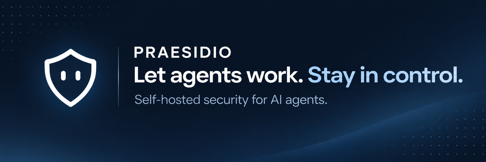
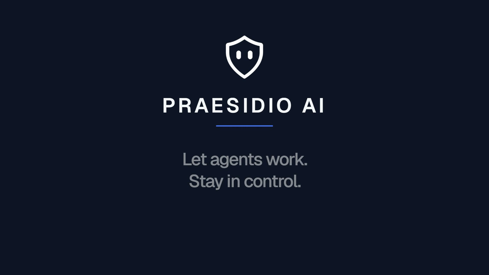

<!-- Updated for PRAESIDIO AI, 2026-11-20: repository overview and user-supplied banner. -->


# PRAESIDIO AI

[](https://github.com/mnmalali/PRAESIDIO/actions/workflows/praesidio-ci.yml)
[](LICENSE)

**Inspect agent actions, apply policy, and keep an evidence trail.** PRAESIDIO is a self-hosted security runtime for supported AI agent integrations. It pairs agent events with a local classifier, records verdicts in a private dashboard, and can gate tool execution where the integration supports it.

[](website/public/media/PRAESIDIO-launch-1080p.mp4?raw=1)

Watch the [PRAESIDIO launch film](website/public/media/PRAESIDIO-launch-1080p.mp4?raw=1). Its product scenes are illustrative.

[Quick start](#quick-start) · [Integrations](#integrations) · [Security boundaries](#security-boundaries) · [Architecture](#architecture) · [Contributing](#develop-and-contribute)

## What PRAESIDIO includes

| Component | Purpose |
| --- | --- |
| **Security runtime** | Go API and WebSocket backend, policy evaluation, event storage, alerts, and a local model connection. |
| **Operator dashboard** | Review agent profiles, proposed actions, verdicts, and events in a private Next.js application. |
| **Agent integrations** | Python and TypeScript SDKs, a Claude Code hook plugin, and a stdio MCP bridge for other agent harnesses. |
| **Security workflows** | Five original PRAESIDIO skills and three Claude Code reviewer agents for audits, application security, agent configuration review, and AI evaluation. |
| **Public website** | A separate Next.js site with a clearly labelled simulated demo; it does not run the security backend. |

## Quick start

### 1. Prepare a local model

Install Docker with Compose v2 and NVIDIA Container Toolkit on a machine with a compatible NVIDIA GPU. Place a properly licensed GGUF model in `models/`. Model weights are **not** included; check the model's memory requirements before starting.

```sh
git clone https://github.com/mnmalali/PRAESIDIO.git
cd PRAESIDIO
# Copy your licensed GGUF file into models/ before running bootstrap.
docker compose --profile setup run --rm setup bootstrap --gguf your-model.gguf
docker compose --profile llm up -d
```

Replace `your-model.gguf` with the file you placed in `models/`. Bootstrap creates local configuration and the SQLite database, then prints an initial administrator password. Keep that password private.

### 2. Configure an agent

Open **http://localhost:3000**, sign in as `admin@localhost`, and change the initial password. Create an agent profile, choose its execution mode, and issue an API key in Settings. The backend WebSocket endpoint defaults to `ws://localhost:8080/ws`.

### 3. Connect an integration

For the Python SDK, install from this checkout:

```sh
python -m venv .venv
# Activate .venv using your shell.
python -m pip install -e ./sdk/python
```

Supply `PRAESIDIO_API_KEY` through your environment or secret manager, then initialize `praesidio` in a [supported agent integration](sdk/python/README.md). Keep keys out of source files and chat logs. The Python and TypeScript package names in this repository have **not** been published to PyPI or npm.

## Integrations

| Agent or framework | Integration | Behavior |
| --- | --- | --- |
| Claude Code | [Hook plugin](integrations/claude-code/README.md) | Intercepts supported tool calls and applies the configured backend policy. |
| LangChain / LangGraph and supported Python agents | [Python SDK](sdk/python/README.md) | Captures events and can gate supported tool execution paths. |
| TypeScript / OpenAI | [TypeScript SDK](sdk/typescript/README.md) | Streams events and waits for verdicts on supported tool paths. |
| Codex and other MCP clients | [MCP bridge](integrations/mcp/README.md) | Explicit **advisory** status and proposed-action review tools. The client must call and honor a review result. |
| Hermes Agent and OpenClaw | [MCP registration guide](integrations/mcp/README.md) | Registration instructions are provided; client-side operation has not been verified here. |

The five [PRAESIDIO security skills](skills/) are mirrored for Codex and bundled with the Claude Code plugin. The [security ecosystem catalog](docs/praesidio/SECURITY_ECOSYSTEM.md) indexes external projects for research; their code and skill packs are not bundled.

## Architecture

```text
Supported agent / Claude Code hook ──► PRAESIDIO backend ──► local classifier
              │                              │
              │                              ├─ policy and verdicts
              │                              └─ SQLite event history
              └─ supported tool gate                    │
                                                       ▼
                                                private dashboard

Codex / other MCP client ──► advisory MCP bridge ──► backend review
```

The backend and private dashboard run together under Docker Compose. The public [website](website/README.md) is built and deployed separately.

## Security boundaries

> [!IMPORTANT]
> PRAESIDIO only observes or gates paths connected through a supported integration. **ALERT** mode records activity without blocking. The MCP review tool is advisory, and some SDK timeout or missing-policy paths allow execution. A successful connection does not prove model health or a prevention guarantee.

Local tests cover the backend, SDKs, plugin, builds, Docker images, and synthetic classifier scenarios. Full model-backed operation, production failure behavior, and Hermes Agent/OpenClaw client interoperation remain open validation work. See the [verification report](docs/praesidio/RELEASE_REPORT.md), [compatibility notes](docs/praesidio/COMPATIBILITY.md), and [security policy](SECURITY.md) before a sensitive deployment.

## Develop and contribute

```sh
# Run backend tests from the repository root.
(cd backend && go test ./...)

# Start the public website separately.
(cd website && npm ci && npm run dev)
```

The website runs at **http://127.0.0.1:3001/**. The private dashboard, runtime, and website have separate build and deployment paths. Read [CONTRIBUTING.md](CONTRIBUTING.md) for contributions and [SECURITY.md](SECURITY.md) for vulnerability reports.

## License and provenance

PRAESIDIO is distributed under [Apache-2.0](LICENSE). The original copyright notices and contributor history are preserved. See [source attribution](UPSTREAM_ATTRIBUTION.md) and [third-party notices](docs/praesidio/THIRD_PARTY.md).
